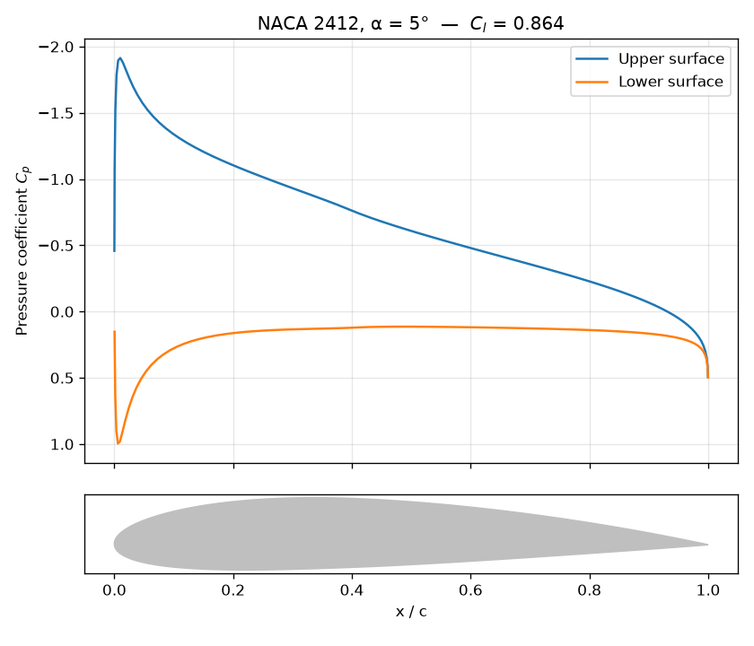
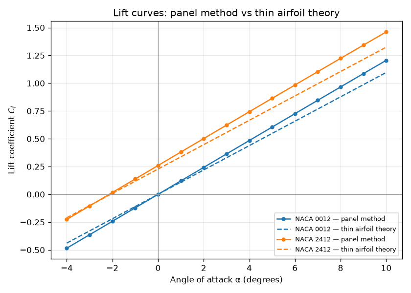
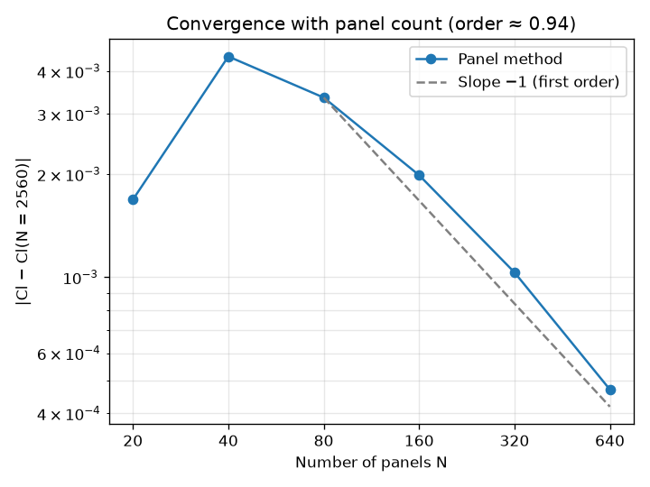

# Airfoil Panel Method

A 2D panel method, written from scratch in Python, that computes the pressure distribution and lift on NACA 4-digit airfoils in inviscid, incompressible flow. It is validated against thin airfoil theory and checked with a panel-count convergence study.

## How it works

The airfoil surface is split into N straight panels. Each panel carries its own constant-strength **source**, and all panels share one constant-strength **vortex** (the Hess-Smith method). That gives N + 1 unknowns, solved as a linear system:

- **N equations, flow tangency:** at each panel's midpoint, no flow passes through the surface.
- **1 equation, the Kutta condition:** the flow leaves the trailing edge smoothly, so the tangential velocities on the two trailing-edge panels are equal and opposite.

The solution gives the surface velocity, the pressure coefficient $C_p = 1 - (V/V_\infty)^2$, and the lift coefficient. Lift is calculated two independent ways, from the circulation (Kutta-Joukowski) and by integrating the pressure around the surface, as an internal consistency check.

Geometry uses the standard NACA 4-digit equations with cosine spacing, which puts more panels near the leading and trailing edges where the pressure changes fastest.

## Results

### Pressure distribution, NACA 2412 at 5°



The suction peak just behind the leading edge on the upper surface, and the pressures meeting at the trailing edge (the Kutta condition), are what potential flow theory predicts.

### Lift curves vs thin airfoil theory



| Airfoil | Panel method slope (/rad) | Thin airfoil theory | Thickness-corrected theory, 2π(1 + 0.77 t/c) |
|---|---|---|---|
| NACA 0012 | 6.92 | 6.28 | 6.86 |
| NACA 2412 | 6.91 | 6.28 | 6.86 |

- **Zero-lift angle:** for the cambered NACA 2412 the panel method crosses zero lift at about −2.1°, matching thin airfoil theory's −2.08°.
- **Lift slope:** the panel method's slope is about 10% above the thin-airfoil value of 2π. That is not an error. Thin airfoil theory ignores thickness, and thick sections produce more lift per degree in inviscid flow. Once corrected for 12% thickness, the theory and the panel method agree to within 1%.
- **Real air:** a real wing produces slightly *less* lift than either, because the boundary layer (viscosity) that this model leaves out reduces the effective camber. This is the main limitation of an inviscid method, and the reason tools like XFOIL couple a panel method to a boundary-layer model.

### Convergence with panel count



The error in $C_l$ (relative to a 2560-panel reference) falls at roughly **first order**: doubling the panels about halves the error. That is expected for constant-strength panels, where the error is dominated by how the Kutta condition is applied at the sharp trailing edge. Below about 80 panels the grid is too coarse for the error to fall regularly. 160 panels gives $C_l$ to within about 0.2%.

As an extra check, the lift from circulation and from integrating pressure agree to within 0.8% at 160 panels.

## Run it

```
pip install -r requirements.txt
python main.py
```

This prints the validation tables and saves the three plots.

## Files

| File | Purpose |
|---|---|
| `naca.py` | NACA 4-digit geometry and thin-airfoil zero-lift angle |
| `panel.py` | Hess-Smith source + vortex panel solver |
| `main.py` | Runs the validation study and makes the plots |

## Next steps

- Linear-strength vortex panels, to improve the convergence order
- A simple boundary-layer model to estimate viscous drag and the reduction in lift
- Comparison against published wind tunnel data for the NACA 0012

## Reference

Katz, J. and Plotkin, A., *Low-Speed Aerodynamics*, 2nd ed., Cambridge University Press (2001), ch. 11.
